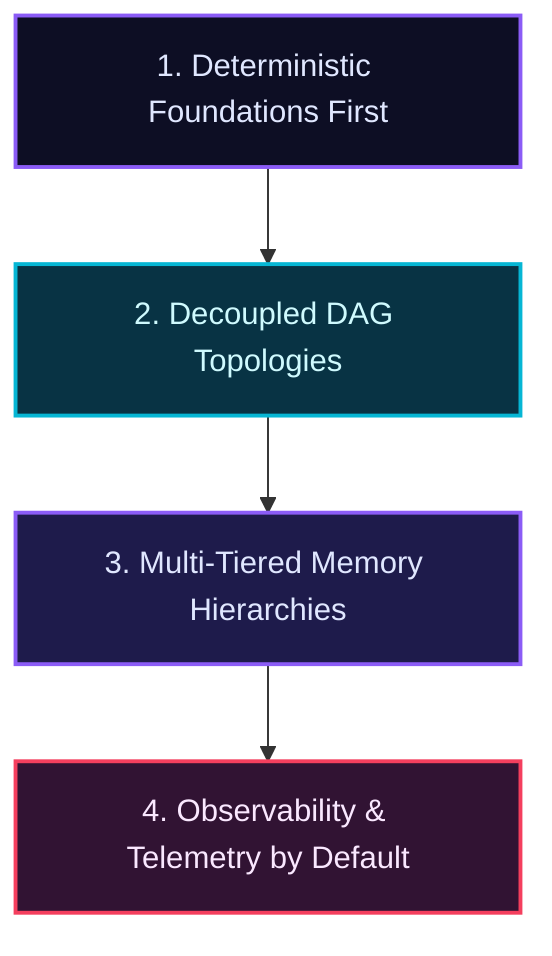

<!-- ================================================================= -->
<!--                       XYANNCAT PROFILE README                     -->
<!-- ================================================================= -->

<div align="center">
  <picture>
    <source media="(prefers-color-scheme: dark)" srcset="./assets/profile-banner-dark.svg">
    <source media="(prefers-color-scheme: light)" srcset="./assets/profile-banner-light.svg">
    
  </picture>
</div>

<br>

<div align="center">
  
</div>

<br>

<div align="center">
  <h1>
    
  </h1>
</div>

<div align="center">
  <strong>Thoughtful systems. Deterministic foundations. Autonomous intelligence.</strong><br>
  <sub>Turning complex agentic workflows into dependable, observable, and production-grade software.</sub>
</div>

<br>

<div align="center">
  <a href="https://github.com/xyanncat"></a>
  &nbsp;
  <a href="https://github.com/xyanncat?tab=repositories"></a>
  &nbsp;
  <a href="https://komarev.com/ghpvc/?username=xyanncat&style=for-the-badge&color=06b6d4&label=Profile+Views&labelColor=18181b"></a>
  &nbsp;
  <a href="https://github.com/xyanncat?tab=followers"></a>
</div>

<br>

<div align="center">
  <a href="#-system-directive">Directive</a>&nbsp;&nbsp;✦&nbsp;&nbsp;
  <a href="#-flagship-systems--engineering-portfolio">Flagship Systems</a>&nbsp;&nbsp;✦&nbsp;&nbsp;
  <a href="#-engineering-toolbox--tech-stack">Toolbox</a>&nbsp;&nbsp;✦&nbsp;&nbsp;
  <a href="#-architecture--engineering-philosophy">Architecture</a>&nbsp;&nbsp;✦&nbsp;&nbsp;
  <a href="#-live-telemetry--activity">Telemetry</a>&nbsp;&nbsp;✦&nbsp;&nbsp;
  <a href="#-connect--collaborate">Connect</a>
</div>

<br>

---

## ⚡ System Directive

```text
╭─────────────────────────────── SYSTEM STATUS : ONLINE ────────────────────────────────╮
│                                                                                       │
│  OPERATOR     : xyanncat (Dev cat / Manas)                                           │
│  DOMAIN       : Agentic AI Systems · Multi-Agent DAGs · MLOps Forensics · Full-Stack │
│  DIRECTIVE    : Engineering resilient multi-LLM workflows with deterministic quality  │
│                                                                                       │
│  CURRENT SPECIALIZATIONS:                                                             │
│  ✦ Multi-Agent Task Graphs : DAG planning, parallel dispatch, and tool sandboxing    │
│  ✦ Cognitive Memory Engines: 5-Layer memory (Working, Short, Long, Semantic, Episodic)│
│  ✦ Model Regression Gating : Statistical 1.5x σ delta isolation & rollback hooks     │
│  ✦ AI Pipeline Forensics   : Trace reconstruction, secret-redacted root-cause analysis│
│                                                                                       │
│  CORE ETHOS:                                                                          │
│  clarity over cleverness · quality over noise · progress over perfection              │
╰───────────────────────────────────────────────────────────────────────────────────────╯
```

---

## 🚀 Flagship Systems & Engineering Portfolio

Selected open-source frameworks and production systems architected from first principles:

<table>
  <!-- Row 1: Agent Orchestration & Noa -->
  <tr>
    <td width="50%" valign="top">
      <div align="center">
        <h3>👺 <a href="https://github.com/xyanncat/agent-orchestration-system">Agent Orchestration System</a></h3>
      </div>
      <p>
        <strong>High-performance multi-agent framework</strong> powered by <strong>NVIDIA NIM</strong> and <strong>OpenRouter</strong> multi-LLM routing. Decomposes goals into <strong>Directed Acyclic Task Graphs (DAGs)</strong> with specialized panels: <code>Planner</code>, <code>Researcher</code>, <code>Coder</code>, <code>Reviewer</code>, and <code>Executor</code>.
      </p>
      <ul>
        <li><b>Parallel DAG Scheduler</b> with auto-retry, fallback, and tool sandboxing.</li>
        <li><b>Real-time SSE progress streaming</b> + human-in-the-loop escalation gates.</li>
        <li><b>Shared state memory</b> backed by SQLite long-term persistence.</li>
      </ul>
      <p align="center">
        <a href="https://github.com/xyanncat/agent-orchestration-system"></a>
        <a href="https://github.com/xyanncat/agent-orchestration-system"></a>
        <a href="https://github.com/xyanncat/agent-orchestration-system"></a>
        <a href="https://github.com/xyanncat/agent-orchestration-system"></a>
        
      </p>
    </td>
    <td width="50%" valign="top">
      <div align="center">
        <h3>✦ <a href="https://github.com/xyanncat/Noa">Noa — Autonomous AI Engine</a></h3>
      </div>
      <p>
        <strong>Autonomous AI system with a 5-Layer Memory Engine</strong>, multi-step autonomous planner, 12-tool ecosystem, and multi-platform client suite. Operates with zero cloud dependencies via a built-in offline engine or connects to Gemini/GPT-4o.
      </p>
      <ul>
        <li><b>5-Layer Memory Architecture</b>: Working, Short-Term, Long-Term, Semantic, Episodic.</li>
        <li><b>Liquid Glass UI Kit</b> + <b>Cortex Responsive Dashboard</b>.</li>
        <li><b>Multi-Platform Clients</b>: Desktop (Tauri v2 + Rust) & Signed Android APK.</li>
      </ul>
      <p align="center">
        <a href="https://github.com/xyanncat/Noa"></a>
        <a href="https://github.com/xyanncat/Noa"></a>
        <a href="https://github.com/xyanncat/Noa"></a>
        <a href="https://github.com/xyanncat/Noa/releases/tag/v2.2.0"></a>
        
      </p>
    </td>
  </tr>

  <!-- Row 2: Regression Detection & Forensic-0 -->
  <tr>
    <td width="50%" valign="top">
      <div align="center">
        <h3>🎯 <a href="https://github.com/xyanncat/Model-regression-detection-system">Model Regression Detection System</a></h3>
      </div>
      <p>
        <strong>Production-grade MLOps engine</strong> that detects, classifies, and reports quality/behavior regressions between baseline and candidate model runs in multi-model orchestration routers.
      </p>
      <ul>
        <li><b>Statistical 1.5× σ Noise Thresholding</b> against rolling variance.</li>
        <li><b>Cheapest-first root cause isolator</b>: Truncation → Prompt diff → Model diff.</li>
        <li><b>Strict Zod schemas</b> + N≥3 reproduction gate for critical severity rollbacks.</li>
      </ul>
      <p align="center">
        <a href="https://github.com/xyanncat/Model-regression-detection-system"></a>
        <a href="https://github.com/xyanncat/Model-regression-detection-system"></a>
        <a href="https://github.com/xyanncat/Model-regression-detection-system"></a>
        
      </p>
    </td>
    <td width="50%" valign="top">
      <div align="center">
        <h3>🕵️ <a href="https://github.com/xyanncat/Failure-forensics-tool-for-AI-pipelines">Forensic-0 — AI Pipeline Diagnostics</a></h3>
      </div>
      <p>
        <strong>Global command-line forensics engine</strong> for AI pipeline failures. Ingests execution traces, DAG topology, and error payloads to reconstruct graphs, detect anomalies, and isolate root causes.
      </p>
      <ul>
        <li><b>Deterministic Phase 1–2 Engine</b>: Zero external dependencies (Python stdlib).</li>
        <li><b>Anomaly & Divergence Diffs</b>: Latency spikes, output truncation, verifier misses.</li>
        <li><b>Secret-redacted LLM reasoning</b> (OpenAI / Anthropic / Ollama) + offline <code>--dry-run</code>.</li>
      </ul>
      <p align="center">
        <a href="https://github.com/xyanncat/Failure-forensics-tool-for-AI-pipelines"></a>
        <a href="https://github.com/xyanncat/Failure-forensics-tool-for-AI-pipelines"></a>
        <a href="https://github.com/xyanncat/Failure-forensics-tool-for-AI-pipelines"></a>
        
      </p>
    </td>
  </tr>

  <!-- Row 3: Eternity & Makima -->
  <tr>
    <td width="50%" valign="top">
      <div align="center">
        <h3>🛡️ <a href="https://github.com/xyanncat/Eternity.">Eternity. — Bot & Next.js 16 Dashboard</a></h3>
      </div>
      <p>
        <strong>Production-ready Discord bot & full-stack web dashboard monorepo</strong>. Features moderation, audit logging, ticketing with dynamic HTML transcripts, XP economy, and AI utilities.
      </p>
      <ul>
        <li><b>Next.js 16 App Router</b> dashboard with NextAuth Discord OAuth2.</li>
        <li><b>PostgreSQL + Prisma ORM</b>, Redis caching, and automated Stripe billing.</li>
        <li><b>Dynamic Rank Cards</b> generated with hardware-accelerated <code>@napi-rs/canvas</code>.</li>
      </ul>
      <p align="center">
        <a href="https://github.com/xyanncat/Eternity."></a>
        <a href="https://github.com/xyanncat/Eternity."></a>
        <a href="https://github.com/xyanncat/Eternity."></a>
        <a href="https://github.com/xyanncat/Eternity."></a>
      </p>
    </td>
    <td width="50%" valign="top">
      <div align="center">
        <h3>⛓️ <a href="https://github.com/xyanncat/Makima">Makima — Groq AI Live Stream Bot</a></h3>
      </div>
      <p>
        <strong>Ultra-fast multi-platform AI live stream chatbot</strong> running on the Groq API. Automatically connects to and manages chatrooms across YouTube Live, Twitch, and Kick simultaneously.
      </p>
      <ul>
        <li><b>Ultra-low latency Groq AI</b>: Instant fallback from Llama 3.1 70B to 8B.</li>
        <li><b>YouTube Data API live-chat poller</b> with quota backoff & token refresh.</li>
        <li><b>Real-time Telemetry Dashboard</b> with glassmorphism console feeds.</li>
      </ul>
      <p align="center">
        <a href="https://github.com/xyanncat/Makima"></a>
        <a href="https://github.com/xyanncat/Makima"></a>
        <a href="https://github.com/xyanncat/Makima"></a>
        <a href="https://github.com/xyanncat/Makima"></a>
      </p>
    </td>
  </tr>
</table>

<br>

> **Taxonomy & Repository Scanning Guide:**
>
> | Label | Operational Meaning |
> | :--- | :--- |
> | `FEATURED` | High-polish production architecture representing core engineering capability |
> | `BUILDING` | Actively developed system with frequent structural commits and benchmark updates |
> | `OPEN SOURCE` | Public tool with documented contribution pathways, test suites, and issue trackers |
> | `EXPERIMENT` | Focused algorithmic exploration, proof-of-concept, or prototype |
> | `ARCHIVED` | Preserved complete reference implementation |

---

## 🧰 Engineering Toolbox & Tech Stack

A battle-tested stack spanning cognitive AI architectures, distributed backends, systems programming, and modern interfaces:

<div align="center">

### 🤖 Agentic AI & Multi-LLM Routing
<p>
  
  
  
  
  
  
  
</p>

### 💻 Core Languages
<p>
  
  
  
  
  
  
</p>

### ⚙️ Backend & Distributed Systems
<p>
  
  
  
  
  
  
</p>

### 🎨 Frontend & Cross-Platform Applications
<p>
  
  
  
  
  
  
</p>

### 🗄️ Database, Caching & ORM
<p>
  
  
  
  
  
</p>

### 🛠️ Quality Assurance, DevOps & Infrastructure
<p>
  
  
  
  
  
  
</p>

</div>

---

## 🏛️ Architecture & Engineering Philosophy

When building complex agentic frameworks and autonomous engines, four principles govern the codebase:



1. **Deterministic Foundations First**: An AI pipeline is only as reliable as its deterministic scaffolding. Tools like `Forensic-0` use zero-dependency Python standard library verification before delegating ambiguous reasoning to LLMs.
2. **Decoupled DAG Topologies**: Autonomous agents perform best when partitioned into single-responsibility nodes (Planner, Researcher, Coder, Reviewer, Executor) communicating over strictly validated schemas (Zod / Pydantic) with automated retry and fallback routing.
3. **Multi-Tiered Memory Hierarchies**: Context shouldn't bloat unbounded. Partitioning state across 5 distinct memory layers (Working, Short-Term, Long-Term, Semantic, Episodic) guarantees continuity without catastrophic context rot.
4. **Observability by Default**: Every agent step, tool invocation, token count, and latency metric is streamed via SSE or recorded in structured precedent scoreboards for instant root-cause analysis.

---

## 📊 Live Telemetry & Activity

<div align="center">
  <table border="0" align="center">
    <tr>
      <td align="center" width="50%">
        
      </td>
      <td align="center" width="50%">
        
      </td>
    </tr>
  </table>
</div>

---

## 🌐 Connect & Collaborate

Whether you're exploring multi-agent architectures, discussing LLM evaluation benchmarks, or collaborating on high-performance open-source tools, my inbox is always open.

<div align="center">

<p>
  <a href="https://github.com/xyanncat"></a>
  &nbsp;
  <a href="https://github.com/xyanncat?tab=repositories"></a>
  &nbsp;
  <a href="https://github.com/xyanncat?tab=followers"></a>
</p>

<sub><i>Open to technical discussions, architecture reviews, and high-impact AI infrastructure collaboration.</i></sub>

</div>

<br>

<div align="center">
  <picture>
    <source media="(prefers-color-scheme: dark)" srcset="./assets/profile-footer.svg">
    <source media="(prefers-color-scheme: light)" srcset="./assets/profile-footer.svg">
    
  </picture>
</div>
