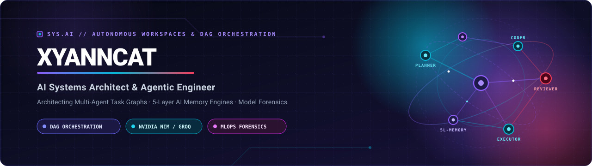

<!-- Profile README — xyanncat -->

<picture>
  <source media="(prefers-color-scheme: dark)"  srcset="./assets/profile-banner-dark.svg">
  <source media="(prefers-color-scheme: light)" srcset="./assets/profile-banner-light.svg">
  
</picture>

<br>

<div align="center">
  
</div>

<br>

<div align="center">
  <h1>
    
  </h1>
</div>

<div align="center">
  <em>Thoughtful software. Clear interfaces. Reliable systems.</em><br>
  <sub>Turning fuzzy ideas into useful, well-crafted digital products — one autonomous agent at a time.</sub>
</div>

<br>

<div align="center">

[](https://github.com/xyanncat)
&nbsp;
[](https://github.com/xyanncat)

</div>

<br>

---

## ⚡ What I'm building

I operate at the intersection of **Agentic AI**, **MLOps**, and **Systems Engineering** — building the infrastructure that makes AI agents reliable, observable, and autonomous in production.

```text
Focus      →  Agentic AI systems · Model reliability · Developer tooling
Currently  →  Building an interconnected AI pipeline ecosystem
Principles →  clarity over cleverness · quality over noise · progress over perfection
```

---

## 🚀 Featured Projects

<table>
  <tr>
    <td width="50%" valign="top">
      <h3>🤖 <a href="https://github.com/xyanncat/agent-orchestration-system">Agent Orchestration System</a></h3>
      <p>Multi-agent orchestration framework where specialized AI agents collaborate via <strong>parallel task graphs</strong>, auto-retry/fallback, and shared memory. Multi-LLM backend (NVIDIA NIM + OpenRouter).</p>
      <p>
        
        
        
      </p>
    </td>
    <td width="50%" valign="top">
      <h3>🔍 <a href="https://github.com/xyanncat/Model-regression-detection-system">Model Regression Detection</a></h3>
      <p>Continuous model monitoring system that detects <strong>performance regressions</strong> across deployment cycles — essential for production ML reliability.</p>
      <p>
        
        
        
      </p>
    </td>
  </tr>
  <tr>
    <td width="50%" valign="top">
      <h3>🛠️ <a href="https://github.com/xyanncat/Failure-forensics-tool-for-AI-pipelines">Failure Forensics Tool</a></h3>
      <p>Root-cause analysis and diagnostic tooling for AI pipeline failures. Designed for deep introspection of training and data pipelines where failures are opaque.</p>
      <p>
        
        
      </p>
    </td>
    <td width="50%" valign="top">
      <h3>🧠 <a href="https://github.com/xyanncat/Noa">Noa — Autonomous Workspace</a></h3>
      <p>An autonomous, self-managing workspace powered by AI agents. The persistent environment that ties orchestration, monitoring, and tooling together.</p>
      <p>
        
        
      </p>
    </td>
  </tr>
  <tr>
    <td width="50%" valign="top">
      <h3>✨ <a href="https://github.com/xyanncat/Eternity.">Eternity. Dashboard</a></h3>
      <p>A sleek web dashboard deployed live. Where design craft meets functional interfaces — clean TypeScript, production-ready on Vercel.</p>
      <p>
        
        
        <a href="https://eternity-dashboard.vercel.app"></a>
      </p>
    </td>
    <td width="50%" valign="top">
      <h3>⚡ <a href="https://github.com/xyanncat/Raiden">Raiden</a></h3>
      <p>A JavaScript web application — fast, focused, and deployed. The older sibling in the frontend lineage.</p>
      <p>
        
        
        <a href="https://raiden-peach.vercel.app"></a>
      </p>
    </td>
  </tr>
</table>

> **How to read my repos:**
>
> | Badge | Meaning |
> |:--|:--|
> | `FEATURED` | A polished project that best represents my work |
> | `BUILDING` | Actively developed; expect frequent changes |
> | `OPEN SOURCE` | Contributions, issues, and ideas are welcome |
> | `EXPERIMENT` | A focused prototype or technical exploration |
> | `ARCHIVED` | Complete or preserved for reference |

---

## 🧰 Toolbox

<div align="center">

**Languages**


**AI / ML Stack**


**Web & Deployment**


**Tools**


</div>

---

## 📊 GitHub Stats

<div align="center">


&nbsp;


</div>

<div align="center">
  
</div>

---

## 🌐 Connect

<div align="center">

I'm always open to interesting conversations, collaborations, and ideas.<br>
The best way to reach me is through GitHub — open an issue, a discussion, or just explore the pinned repositories below.

<br>

[](https://github.com/xyanncat?tab=followers)

</div>

---

<div align="center">
  
  <br>
  <sub><em>building in public · learning always · shipping often</em></sub>
</div>
