<!-- ================================================================= -->
<!--                       XYANNCAT PROFILE README                     -->
<!-- ================================================================= -->

  <picture>
    <source media="(prefers-color-scheme: dark)" srcset="./assets/profile-banner-dark.svg">
    <source media="(prefers-color-scheme: light)" srcset="./assets/profile-banner-light.svg">
    
  </picture>

 

  

 

  <h1>
    
  </h1>

  <strong>Deterministic foundations. Observable intelligence. Systems built in the open.</strong> 
  Multi-agent orchestration, model diagnostics, Discord platforms, and Android AI tools.

 

  
  &nbsp;
  
  &nbsp;
  

 

  <picture>
    <source media="(prefers-color-scheme: dark)" srcset="./assets/profile-pulse-dark.svg">
    <source media="(prefers-color-scheme: light)" srcset="./assets/profile-pulse-light.svg">
    
  </picture>

 

  <a href="#now">Now</a> &nbsp;✦&nbsp;
  <a href="#live-pulse">Live Pulse</a> &nbsp;✦&nbsp;
  <a href="#selected-engineering-work">Selected Work</a> &nbsp;✦&nbsp;
  <a href="#snapshot">Snapshot</a> &nbsp;✦&nbsp;
  <a href="#engineering-themes">Engineering Themes</a> &nbsp;✦&nbsp;
  <a href="#toolbox">Toolbox</a> &nbsp;✦&nbsp;
  <a href="#connect">Connect</a>

 

---

## Now

| Current focus | What it is | State |
| :--- | :--- | :--- |
| [Ei-Void](https://github.com/xyanncat/Ei-Void) | OLED Android assistant, local-first reminders, and a guarded GitHub coding agent | **Active** |
| [Ei-point](https://github.com/xyanncat/Ei-point) | Six-identity Discord platform with shared domain services and a Kafka-themed dashboard | **In development** |

> Ei-point is intentionally presented as a development build: local implementation is substantial, but live Discord, provider, payment, and recovery acceptance gates remain open.

---

## Live Pulse

<table>
  <tr>
    <td width="50%" valign="top">
      
    </td>
    <td width="50%" valign="top">
      
    </td>
  </tr>
</table>

Live metrics refresh from public GitHub data.

---

## Selected Engineering Work

Seven repositories, chosen to show the full path from agent infrastructure to current products.

<table>
  <tr>
    <td width="50%" valign="top">
      <h3><a href="https://github.com/xyanncat/Ei-Void">Ei-Void</a> <code>ACTIVE</code></h3>
      
<strong>An OLED Android AI assistant that also keeps bills, renewals, and code within reach.</strong>

      <ul>
        <li>Assistant home, slide-out drawer, capability cards, and a restrained OLED design system.</li>
        <li>Local-first payment reminders with exact Android alarms, Mark Paid, Snooze, and Discord delivery.</li>
        <li>Phone-native coding agent that clones a GitHub repository and edits it through guarded tools.</li>
      </ul>
      

        
        
        
      

    </td>
    <td width="50%" valign="top">
      <h3><a href="https://github.com/xyanncat/Ei-point">Ei-point</a> <code>IN DEVELOPMENT</code></h3>
      
<strong>A modular TypeScript and Python monorepo for a coordinated Discord bot fleet.</strong>

      <ul>
        <li>Six identities—Kafka, Cyrene, Robin, Cipher, SilverWolf, and Himiko—behind shared domain modules.</li>
        <li>Fastify API, background workers, PostgreSQL, migrations, health checks, and immutable release manifests.</li>
        <li>Kafka-themed public site and dashboard with documented phase gates and recovery procedures.</li>
      </ul>
      

        
        
        
      

    </td>
  </tr>

  <tr>
    <td width="50%" valign="top">
      <h3><a href="https://github.com/xyanncat/Eternyx">Eternyx</a> <code>MAINTAINED</code></h3>
      
<strong>A security-first Discord moderation bot designed for a low-resource Termux host.</strong>

      <ul>
        <li>Slash commands only, every response an embed, and no inbound HTTP ports.</li>
        <li>Least-privilege permissions, hierarchy-safe actions, write-ahead SQLite audit records, and tamper alerts.</li>
        <li>Node.js with <code>node:sqlite</code>, runit supervision, boot hooks, and nightly backups.</li>
      </ul>
      

        
        
        
      

    </td>
    <td width="50%" valign="top">
      <h3><a href="https://github.com/xyanncat/agent-orchestration-system">Agent Orchestration System</a> <code>FOUNDATION</code></h3>
      
<strong>A multi-provider framework that decomposes goals into directed acyclic task graphs.</strong>

      <ul>
        <li>Planner, Researcher, Coder, Reviewer, and Executor panels acting as decoupled DAG nodes.</li>
        <li>Auto-retry, fallback routing, shared state memory, SSE progress, and deterministic offline simulation.</li>
        <li>NVIDIA NIM, OpenRouter, Anthropic, OpenAI, Gemini, and local Ollama providers.</li>
      </ul>
      

        
        
        
      

    </td>
  </tr>

  <tr>
    <td width="50%" valign="top">
      <h3><a href="https://github.com/xyanncat/Failure-forensics-tool-for-AI-pipelines">Forensic-0</a> <code>OPEN SOURCE</code></h3>
      
<strong>A command-line forensics engine for failed AI pipelines.</strong>

      <ul>
        <li>Zero-dependency Python evidence extraction reconstructs DAGs and detects latency, truncation, and divergence anomalies.</li>
        <li>Optional secret-redacted LLM reasoning across OpenAI, Anthropic, and Ollama.</li>
        <li>Fully offline <code>--dry-run</code> mode for reproducible diagnostics.</li>
      </ul>
      

        
        
        
      

    </td>
    <td width="50%" valign="top">
      <h3><a href="https://github.com/xyanncat/Model-regression-detection-system">Model Regression Detection</a> <code>BUILDING</code></h3>
      
<strong>Statistical quality and behavior regression gating for multi-model routers.</strong>

      <ul>
        <li>Flags changes only beyond a <code>1.5 × σ</code> rolling-variance noise threshold.</li>
        <li>Cheapest-first root-cause isolation: truncation, prompt diff, model diff, provider, then eval drift.</li>
        <li>Strict Zod verdicts, severity classes, and an <code>N≥3</code> reproduction gate for critical rollbacks.</li>
      </ul>
      

        
        
        
      

    </td>
  </tr>

  <tr>
    <td width="50%" valign="top">
      <h3><a href="https://github.com/xyanncat/Advanced-Agentic-Coding">llm-trainer</a> <code>FOUNDATION</code></h3>
      
<strong>A hardware-adaptive LLM training framework that lives in the Advanced-Agentic-Coding repository.</strong>

      <ul>
        <li>SFT, GRPO, PPO, DPO, PEFT, LoRA, QLoRA, and TorchAO across NVIDIA, Apple Silicon, AMD, and CPU targets.</li>
        <li>Profiles RAM and VRAM to adapt batch size, sequence length, gradient accumulation, and offloading.</li>
        <li>WandB and TensorBoard logging, LM Eval Harness, and GGUF export.</li>
      </ul>
      

        
        
        
      

    </td>
    <td width="50%" valign="top">
      <h3>How to read the statuses</h3>
      

        <code>ACTIVE</code> — current primary build. 
        <code>IN DEVELOPMENT</code> — implemented surface with explicit open gates. 
        <code>MAINTAINED</code> — working system outside the current rewrite. 
        <code>OPEN SOURCE</code> — documented tool with a reproducible workflow. 
        <code>BUILDING</code> — active engineering with test and CI focus. 
        <code>FOUNDATION</code> — earlier architecture still informing current systems.
      

      

        
      

    </td>
  </tr>
</table>

---

## Repository Snapshot

Values verified from the GitHub API on **27 Nov 2026**. Open each repository for current activity.

| Repository | Stars | Language | Last push |
| :--- | :---: | :--- | :--- |
| [Ei-Void](https://github.com/xyanncat/Ei-Void) | 0 | Kotlin | 2026-11-27 |
| [Ei-point](https://github.com/xyanncat/Ei-point) | 1 | TypeScript | 2026-11-09 |
| [Eternyx](https://github.com/xyanncat/Eternyx) | 1 | JavaScript | 2026-10-18 |
| [agent-orchestration-system](https://github.com/xyanncat/agent-orchestration-system) | 1 | Python | 2026-08-01 |
| [Failure-forensics-tool-for-AI-pipelines](https://github.com/xyanncat/Failure-forensics-tool-for-AI-pipelines) | 1 | Python | 2026-08-01 |
| [Model-regression-detection-system](https://github.com/xyanncat/Model-regression-detection-system) | 1 | TypeScript | 2026-08-01 |
| [Advanced-Agentic-Coding](https://github.com/xyanncat/Advanced-Agentic-Coding) | 1 | Python | 2026-08-01 |

---

## Engineering Themes

1. **Deterministic foundations first** — verify what can be verified locally before delegating ambiguous reasoning to a model.
2. **Decoupled agent topologies** — single-responsibility DAG nodes, validated schemas, retry paths, and explicit fallback routing.
3. **Bounded memory and context** — partition state instead of growing prompts without limit.
4. **Observability by default** — traces, audit records, severity gates, and rollback hooks are part of the design, not an afterthought.

---

## Toolbox

  
  
  
  
  

  
  
  
  
  

  
  
  
  
  

---

## Connect

Open to architecture reviews, AI-pipeline diagnostics, agent infrastructure discussions, and high-impact product collaboration.

  
  &nbsp;
  
  &nbsp;
  

  <picture>
    <source media="(prefers-color-scheme: dark)" srcset="./assets/profile-footer.svg">
    <source media="(prefers-color-scheme: light)" srcset="./assets/profile-footer.svg">
    
  </picture>

